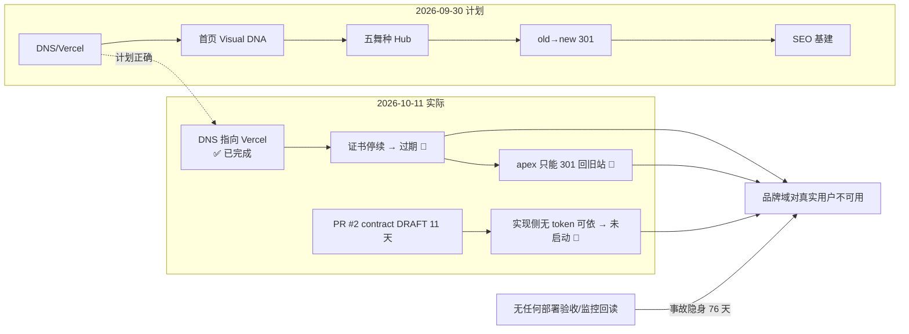
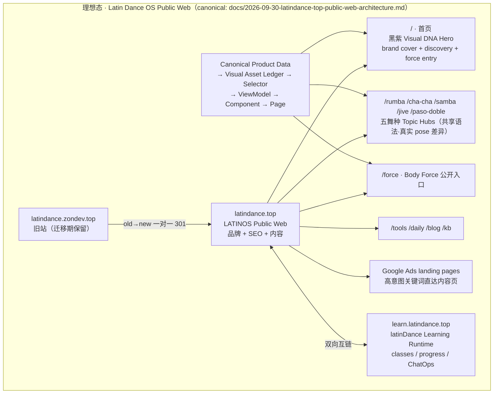
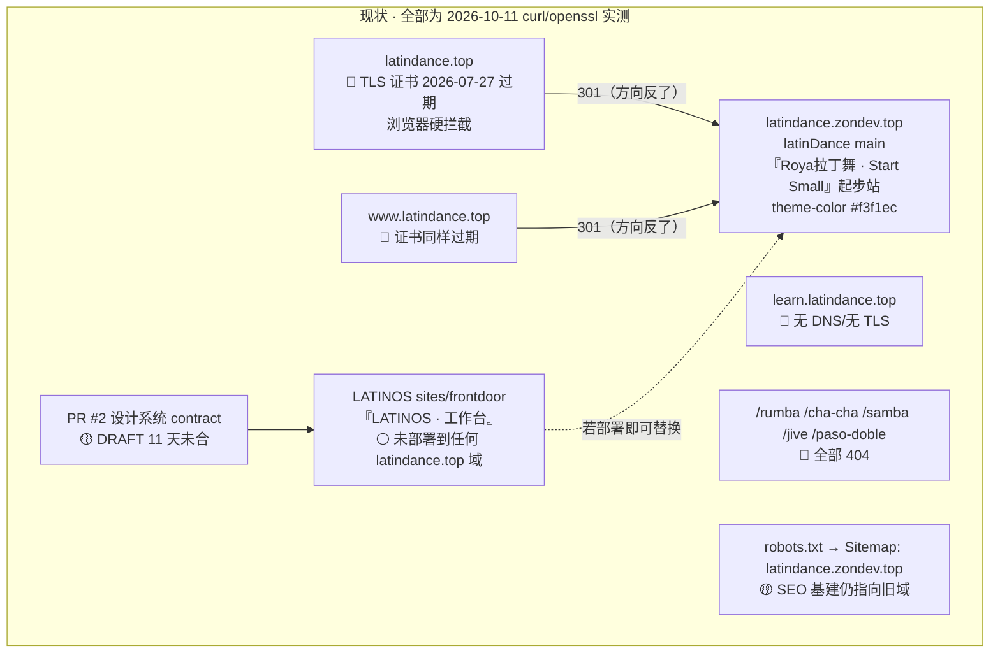
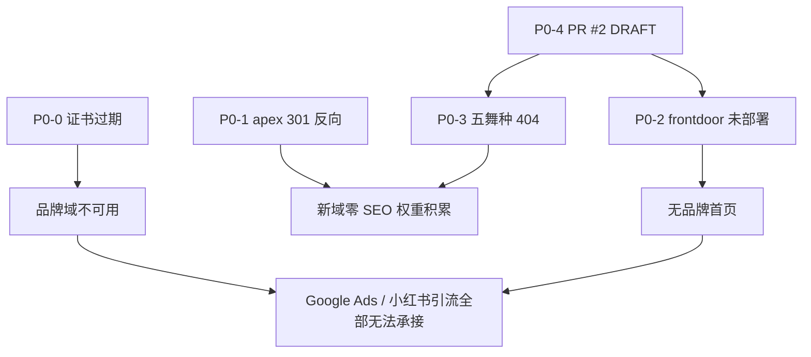
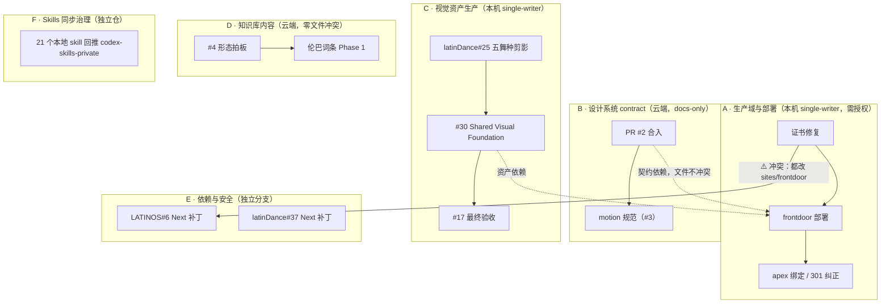

# 2026-10-11 · Latin Dance OS 全盘进度审计：目标 / 现状 / 偏移 / 执行清单

> 审计日期：2026-10-11（Asia/Shanghai）
> 工作区：`/Users/zon/Desktop/LATINOS`
> 路由：`skill-orchestration-router` → `task-continuation-governance` + `planning-routing`/`goal-first`
> 状态：**无目标偏移，但存在严重的执行层停滞与一处生产事故**
> 关联：LATINOS#1 #3 #4 #5 #6 #7 #8 ｜ latinDance#35 #36 #38 #39 ｜ product-hub#193 #217

---

## 0. 先给结论（TL;DR）

1. **方向没错，落地停了**。规范层产出充分（4 份 design contract、URL IA、知识库规划），runtime/部署层 **0 产出**，且已停摆 27 天（LATINOS `main` 最后提交 `d3f2859`，2026-09-30；再往前是 09-14）。
2. **发现一处 P0 生产事故**：`latindance.top` / `www.latindance.top` 的 TLS 证书 **已于 2026-07-27 过期**，浏览器会硬拦截，"品牌首页"对真实用户不可用。这不是推测，是实测（见 §2 证据 E1）。
3. **域名映射与计划相反**：计划是 `旧域 → 301 → 新域`，实测是 `latindance.top → 301 → latindance.zondev.top`。新 apex 目前只是旧学习站的跳转壳。
4. **线上跑的不是本仓代码**：`latindance.zondev.top`（= latindance.top 的最终内容）是 `EOMZON/latinDance` main 的「Roya拉丁舞 · Start Small」起步站；LATINOS `sites/frontdoor`（「LATINOS · 工作台」）**没有部署在任何 `latindance.top` 域上**。
5. **五舞种 topic hub 全部 404**（`/rumba` `/cha-cha` `/samba` `/jive` `/paso-doble`），`#193 §7` 与 `2026-09-30-latindance-top-public-web-architecture.md §7` 的 P0 第 4 项未启动。
6. **下一步唯一正确动作**：先修证书 + 确定 apex 归属（P0-0/P0-1），其余全部排在它后面。

---

## 1. 最初目标（从证据恢复，不做重新解读）

### L0 母目标（本仓 `AGENTS.md` + `MEMORY.md`，长期不变）

```
Latin Dance OS = Daily Latin IP（直播/内容）
               + 拉丁成长网站（资产承接）
               + Dance Tools / Dance OS Demos（产品化）
```

### L1 当前主线（2026-09-30 立项，canonical = `product-hub#193`）

| 项 | 目标 |
|---|---|
| 域 | `latindance.top` = LATINOS Public Web / Brand / SEO / Content；`learn.latindance.top` = latinDance Learning Runtime |
| URL IA | 主域 subdirectory：`/rumba` `/cha-cha` `/samba` `/jive` `/paso-doble` `/force` `/tools` `/daily` `/blog`；**不为每个内容块拆 subdomain** |
| 视觉 | 沿用 2026-09-17 Body Force Visual DNA（warm ivory + charcoal 人体 + 半透明薰衣草紫 force ribbon），**禁止重新探索** |
| 分层 | Canonical Product Data → Visual Asset Ledger → Selector → ViewModel → Component → Page |
| 迁移 | 旧域 `latindance.zondev.top` 迁移期保留，完成 **old→new 一对一 301** 后再释放；不得先删旧 DNS |

canonical 文档：`docs/2026-09-30-latindance-top-public-web-architecture.md`（ACTIVE，origin/main `d3f2859`）

### L2 本仓承载的 P0 清单（来自 `latinDance/docs/handoff/2026-09-30-latindance-top-domain-visual-migration-todolist.md`）

1. latindance.top / www / learn DNS 与 Vercel Project 建立
2. LATINOS 首页沿用 2026-09-17 Visual DNA
3. 五舞种 topic hubs
4. learn 与旧域并行
5. old→new URL map + 301
6. canonical / sitemap / robots / OG / Search Console
7. 统一 analytics event contract
8. 保持 Feishu ChatOps 不修改业务逻辑
9. Product Hub #193 回填实际进度

---

## 2. 证据（全部 2026-10-11 实测，可复现）

| # | 证据 | 命令 | 结果 |
|---|---|---|---|
| E1 | **apex 证书过期** | `openssl s_client -connect latindance.top:443 -servername latindance.top \| openssl x509 -noout -dates` | `notBefore=Apr 28 2026` / **`notAfter=Jul 27 15:19:39 2026 GMT`**；`curl` 报 `SSL certificate problem: certificate has expired` |
| E2 | 对照组有效（排除代理 MITM） | 同命令对 `latindance.zondev.top` / `vercel.com` | `notAfter=Dec 2 2026` / `Dec 24 2026` → 有效，**E1 是真实生产事故** |
| E3 | www 同样过期 | 同上对 `www.latindance.top` | `notAfter=Jul 27 06:49:03 2026 GMT` |
| E4 | apex 301 到旧站（方向反了） | `curl -k -I -L https://latindance.top/` | `HTTP/2 301` + `location: https://latindance.zondev.top/` + `server: Vercel` + `x-vercel-id: sfo1::…` |
| E5 | apex 内容 = 旧站内容 | `md5 -q ld.html z.html` | `7f763f94a8a17983d7daf0935fb58f22`（apex 与 www 与 zondev 三者一致） |
| E6 | 线上站是 latinDance 不是 LATINOS | 页面正文 + `gh search code "Roya拉丁舞" --owner EOMZON` | 命中 `EOMZON/latinDance:app/page.tsx`、`lib/site.ts name: "Roya拉丁舞"`；LATINOS `app/page.tsx` 首页文案为「把拉丁学习，做成一张能走进去的地图。」，**线上无此文案** |
| E7 | 五舞种全 404 | `curl -k -o /dev/null -w "%{http_code}" https://latindance.top/rumba` 等 | `/rumba`=404 `/force`=404 `/daily-latin`=404 `/dance-os`=404；仅 `/` `/tools` `/about`=200 |
| E8 | learn 子域不存在 | `curl -L https://learn.latindance.top/` | `SSL_ERROR_SYSCALL`，无服务 |
| E9 | robots/sitemap 仍指旧域 | `curl -k https://latindance.top/robots.txt` | `Sitemap: https://latindance.zondev.top/sitemap.xml` |
| E10 | 本仓停摆 | `git log -1 --date=iso origin/main` | `d3f2859 2026-09-30 +0800`（27 天无新提交）；4 个文件自 8 月起未跟踪 |
| E11 | 设计系统 PR 未合 | `gh api repos/EOMZON/LATINOS/pulls/2` | `state=open, draft=true, updated_at=2026-09-30T04:39:47Z`（4 份 contract，DRAFT 11 天） |
| E12 | latinDance main 停摆 | `gh api repos/EOMZON/latinDance/commits?sha=main` | 最后 `41defdc 2026-09-30 docs: add latindance.top migration and visual foundation TODO`（**只有 TODO，无实现**） |
| E13 | 安全补丁无 PR | `gh pr list --repo EOMZON/LATINOS` | 仅 PR #2；#6（Next 15.5.27）与 latinDance#37 均无 PR |
| E14 | Skills 漂移 | 对比 `gh api repos/EOMZON/codex-skills-private/contents/` 与 `ls ~/.workbuddy/skills/` | **21 个本地 skill 未同步到私有仓**（含 `vercel-deploy` / `vercel-analytics-ops` / `static-content-workbench`） |

---

## 3. 进展核对表

### 3.1 L0 母目标三条线

| 线 | 理想 | 现状 | 判定 |
|---|---|---|---|
| Daily Latin / 直播 IP | 内容源在飞书，网站有 `/daily` 承接 | 飞书 source-of-truth 已立（`data/feishu/latinos-sources.json`）；**站点无 `/daily` 路由** | 🟡 30% |
| 拉丁成长网站 | `latindance.top` 品牌站 + 五舞种 hub + 知识库 | apex 证书过期 + 301 到旧学习站 + 五舞种 404 | 🔴 10%（且线上不可用） |
| Dance Tools / Demos | `apps/demos` 孵化 → `/tools` 公开入口 | 本地已完成 `skeleton-live` / `latin-dance-game` / `dance-os-demo` / `daily-latin-demo` / `skeleton-live-mac`；**线上 `/tools` 是 latinDance 的 Tap Tempo 练习台，与本仓 demos 无关** | 🟡 60%（本地）/ 🔴 0%（线上） |

### 3.2 L2 的 9 项 P0

| # | P0 项 | 状态 | 证据 |
|---|---|---|---|
| 1 | DNS + Vercel Project | 🟡 部分 | DNS 已指向 Vercel（`76.76.21.21`，NS=dnsowl），但证书停续 → 等价于未正确绑定；learn 无记录 |
| 2 | 首页沿用 09-17 Visual DNA | 🔴 未启动 | PR #2 contract DRAFT；线上首页是 latinDance 起步站 |
| 3 | 五舞种 topic hubs | 🔴 未启动 | E7 全 404 |
| 4 | learn 与旧域并行 | 🔴 未启动 | E8 |
| 5 | old→new 301 | 🔴 **方向反了** | E4：new→old |
| 6 | canonical/sitemap/robots/SC | 🟡 部分 | E9：robots 仍声明旧域 sitemap |
| 7 | analytics event contract | 🔴 未启动 | 无证据 |
| 8 | Feishu ChatOps 保持不变 | ✅ 未破坏 | 无改动 |
| 9 | 回填 #193 | 🟡 部分 | #193 有 4 条进度评论（09-30 / 10-01 / 10-04），但**没有一条报告本次发现的线上破损** |

### 3.3 本仓 Issue

| Issue | 标题 | 状态 | 本次判定 |
|---|---|---|---|
| #1 | latindance.top 域名启用（P0） | OPEN | 仍 P0；正文子域名表已被 #193 取代（评论已说明）；**需补：证书过期 + 301 反向证据** |
| #3 | 设计系统实现跟踪 | OPEN | contract 在 PR #2 DRAFT；实现侧（G-3 本机）未启动；motion 规范缺口已登记 |
| #4 | 知识库规划 | OPEN | 4 项待拍板（形态/首舞种/Phase1 时机/社交舞范围）**仍未拍板** → Phase 1 未启动 |
| #5 | 页面转场实现 | OPEN | demo 已在 `~/workspace/vt-demo/vt-demo.html` 验证，等规范批复 |
| #6 | Next 15.5.23→15.5.27 安全补丁 | OPEN | **0 评论、无 PR**；须排在证书事故之后 |
| #7 | （本次新建）latindance.top 证书过期 + apex 301 反向 | — | 见 §6 |
| #8 | （本次新建）frontdoor 未部署 + 五舞种 404 | — | 见 §6 |

---

## 4. 偏移判定

**结论：目标无偏移，执行层有偏移，且存在"规范通胀 / runtime 空转"结构性失衡。**



### 偏移的三条根因

1. **规范先行但无合入授权闸门**：PR #2 以"等用户授权"为由 DRAFT 11 天，实现侧（G-3）又以"等 contract 合入"为由不启动 → 双向等待死锁。**contract 未合入不应阻塞实现**（PR #2 评论里已写"不阻塞 G-3 按 contract 先行实现"，但实际没人执行）。
2. **无人做部署后验收回读**：证书 7-27 过期，直到 10-11 才被发现，#193 的四次进度回填都没覆盖线上可用性 → 缺"发布后 evidence 回读"这一环（对应 `worktree-audit` / `frontend-e2e-release-gate` 的 consumer readback 门禁缺失）。
3. **single-writer 边界过宽**：本机 single-writer 同时锁住"raster 资产 + ledger + runtime 组件 + 截图验证"，任何一环不动，整条线停摆；云端能写的又只有 docs/contract。

---

## 5. 理想 vs 现状（架构图）

### 5.1 理想态（canonical）



### 5.2 现状（2026-10-11 实测）



### 5.3 阻塞链



---

## 6. 执行清单（TodoList + 优先级）

### P0 · 阻塞一切，需 zon 拍板/授权（本周）

| ID | 动作 | 归属 | 前置 | 验收 |
|---|---|---|---|---|
| **P0-0** | 修复 `latindance.top` / `www` 证书过期。诊断 Vercel 中该域绑定的 project；若未绑定或绑错 → 重新绑定到 LATINOS frontdoor project（`prj_5UZwbgmiCRmgEVXdr0zzrPWa2gry`）；触发续期 | 本机（需 Vercel 授权） | 无 | `openssl x509 -dates` → `notAfter` > 2026-12；`curl`（不加 `-k`）返回 200 |
| **P0-1** | 拍板 apex 归属：**A) LATINOS frontdoor 品牌首页（计划口径）** / B) 维持现状（latinDance 起步站） | zon 拍板 | 无 | 写入 #193 与本仓 canonical doc |
| **P0-2** | 把 LATINOS `sites/frontdoor` 部署为独立 Vercel project，先拿 preview URL 验证（`pnpm build && pnpm verify` 必须通过） | 本机 | P0-1=A | preview URL 可访问；`build`/`typecheck`/`smoke:prod` 全绿，记录 exact SHA |
| **P0-3** | apex 绑定 + 把 301 方向纠正为 `旧域 → 新域` | 本机（需授权） | P0-0 + P0-2 | `curl -I https://latindance.zondev.top/` 返回 301 → `latindance.top/...` |
| **P0-4** | 合入 PR #2（4 份 design contract）或明确授权"按 contract 先行实现"解除双向等待 | zon 授权 | 无 | PR #2 merged 或 issue #3 记录授权决议 |

### P1 · P0 解阻塞后自动推进

| ID | 动作 | 归属 | 前置 |
|---|---|---|---|
| P1-1 | 首页 shell + tokens + Hero 落地（80% HTML/CSS/SVG + 20% raster），沿用 09-17 DNA | 本机 single-writer | P0-2/P0-4 |
| P1-2 | 五舞种 topic hubs（`/rumba` 先做，共享语法 + 真实 pose 差异） | 本机 | P1-1 |
| P1-3 | canonical / sitemap / robots / OG / Search Console（把 sitemap 从 zondev 改为 latindance.top） | 云端+本机 | P0-3 |
| P1-4 | `learn.latindance.top` 建立并与旧域并行（latinDance#35） | latinDance | P0-3 |
| P1-5 | Next 15.5.23 → 15.5.27（LATINOS#6）+ latinDance 15.5.10 → 15.5.27（latinDance#37） | 独立分支 | P0-0（不要与部署分支打架） |
| P1-6 | 建立"发布后 evidence 回读"门禁：每次部署后自动跑 `openssl dates` + 关键路由 HTTP 码 + 快照归档 | 云端/本机 | P0-2 |
| P1-7 | 知识库 Phase 1（LATINOS#4）：形态 C 拍板后写伦巴第一批词条 | 云端 | zon 拍板 4 项 |

### P2 · 增强，不插队

| ID | 动作 |
|---|---|
| P2-1 | 页面转场（#3 motion 规范 → #5 实现），不动 Next 大版本 |
| P2-2 | `/tools` 公开入口承接本仓 `apps/demos`（skeleton-live / latin-dance-game） |
| P2-3 | AdSense 申请准备（`docs/analysis/2026-08-19-latin-adsense-site-rebuild-reference.md` 门槛） |
| P2-4 | Analytics event contract |

---

## 7. 并行拆分维度（冲突判定）



| 维度 | 可并行 | 冲突点 | 建议 |
|---|---|---|---|
| A（域/部署） | ✅ 可独立开对话 | 与 E 同改 `sites/frontdoor/package.json` + lock | A 与 E **串行**：先 A 部署稳定，再 E 升级；或 E 独立分支、A 不动依赖 |
| B（设计系统 docs） | ✅ 完全解耦 | 仅 docs/ | 可与 A/C 并行 |
| C（视觉资产） | ✅ 独立仓 | 与 A 共争"本机 single-writer" | C 由另一对话在 `latinDance` 推进，不碰 LATINOS 部署 |
| D（知识库内容） | ✅ 零文件冲突 | 无 | 现在就能并行 |
| E（安全补丁） | ⚠️ 半独立 | 与 A 冲突（见上） | 排在 P0-0 之后 |
| F（Skills 同步） | ✅ 完全解耦 | `codex-skills-private` | 随时可做 |

**推荐并行开 3 个对话**：① A+C（本机主线，含 P0-0/P0-1/P0-2）｜② B+D（云端规划/内容）｜③ F（skills 同步）。E 等 A 完成后并入。

---

## 8. Skills 评估

| Skill | 现状 | 建议 |
|---|---|---|
| `vercel-deploy` / `vercel-analytics-ops` | **仅本地有，未同步到 `codex-skills-private`**（E14） | 本次 P0-0 正是 Vercel 域/证书问题 → 优先回推，并补"**证书有效期回读**"与"**301 方向校验**"两条硬验收 |
| `domain-governance-real-browser` | 两端都有 | 补一条：域名变更前后必须 `openssl x509 -dates` + `curl -I` 方向校验，写进验收 |
| `worktree-audit` / `github-ops` | 两端都有 | 本仓无 worktree，未触发；但"发布后 consumer readback"缺失是本次事故根因 → 建议 P1-6 沉淀为 `frontend-e2e-release-gate` 的一条部署后回读门 |
| `frontend-architecture-guardrails` | 两端都有 | 无改动 |
| `skill-orchestration-router` | 两端都有，本次按 `task-continuation-governance` 执行 | 无改动 |
| `static-content-workbench` | **仅本地有** | 与 `/kb` 知识库落地相关，回推 |
| 21 个本地独占 skill | 未回推 | 用 `skills-sync` / `skill-sync-governance` 批量回推，避免云端 AI 看不到 |

---

## 9. 需要更高级云端 AI 评估的内容（提示词见 §10）

1. `latindance.top` 证书停续的根因判定（Vercel 域未绑定 / 项目删除 / DNS 半配置），以及"零停机修复 + 不影响旧域"的最短路径
2. apex 归属决策 A（LATINOS 品牌首页）vs B（维持 latinDance 起步站）对 SEO/Ads/品牌三方面的长期影响
3. 「PR #2 未合入 ↔ 实现侧不启动」双向等待死锁的解除方案（contract-as-branch vs 直接合入）
4. 五舞种 topic hub 与 latinDance 视觉资产 #25/#30 的排期耦合解法

---

## 10. 云端 AI 评估提示词（复制即用）

````
你是 Latin Dance 公共网站线的独立评审。只做评估与决策建议，不要改任何文件、不要发起部署。

# 背景
我在做一个长期项目 Latin Dance OS。公共站仓库 EOMZON/LATINOS（Next.js 15.5.23 App Router，sites/frontdoor），
学习 runtime 仓库 EOMZON/latinDance。2026-09-30 立项把品牌域 latindance.top 作为公共站主域，
learn.latindance.top 给学习 runtime，旧域 latindance.zondev.top 做 old→new 一对一 301 后释放。

canonical 架构文档：
https://github.com/EOMZON/LATINOS/blob/main/docs/2026-09-30-latindance-top-public-web-architecture.md
跨仓协调：https://github.com/EOMZON/product-hub/issues/193

# 2026-10-11 实测现状（全部 curl / openssl 实测，非推测）
1. latindance.top TLS 证书 notAfter=2026-07-27，已过期 76 天；www 同样过期。
   对照组 latindance.zondev.top 与 vercel.com 证书均有效，排除代理干扰。
2. https://latindance.top/ 返回 301 → https://latindance.zondev.top/（方向与设计相反）。
   apex / www / 旧域三者页面 md5 完全一致：7f763f94a8a17983d7daf0935fb58f22。
3. 线上内容是 EOMZON/latinDance main 的「Roya拉丁舞 · Start Small」起步站（theme-color #f3f1ec，
   含 Tap Tempo / Practice Timer / Action Feedback 工具台），不是 LATINOS 的 frontdoor。
   LATINOS sites/frontdoor 首页文案「把拉丁学习，做成一张能走进去的地图。」在任何 latindance.top 域上都找不到。
4. /rumba /cha-cha /samba /jive /paso-doble /force /daily-latin /dance-os 全部 404，只有 / /tools /about 200。
5. learn.latindance.top 无 DNS/无 TLS（SSL_ERROR_SYSCALL）。
6. https://latindance.top/robots.txt 内容：Sitemap: https://latindance.zondev.top/sitemap.xml （仍指旧域）。
7. LATINOS main 最后提交 d3f2859（2026-09-30），已 27 天无提交；
   设计系统 PR #2（4 份 contract：design-tokens / color-roles / component-contracts / topic-hub-structure）
   自 2026-09-30 起 DRAFT 未合入。latinDance main 最后提交 41defdc（2026-09-30）只有 TODO 文档。
8. DNS：latindance.top A → 76.76.21.21（Vercel），NS = dnsowl（NameSilo）。

# 请回答这 4 个问题，每题给「结论 + 理由 + 最小动作 + 验收命令」

Q1【根因与修复】latindance.top 证书停续最可能的技术根因是什么（Vercel project 未绑定 / 项目被删 /
   DNS 半配置 / 域在 Vercel 但无 production deployment）？给出「零停机、不动旧域」的最短修复路径，
   并给出每一步的验证命令。注意：我没有把握该域当前绑在哪个 Vercel project，请给出如何在不破坏
   现有服务的前提下先"只读诊断"再决定。

Q2【归属决策】apex（latindance.top）应该服务谁？
   A = LATINOS frontdoor 品牌首页（2026-09-30 立项口径，承载 Google Ads 与小红书引流、五舞种 topic hub）
   B = 维持现状，apex 301 到 latinDance 起步站，LATINOS 只做内容子路径
   请从 SEO 权重积累、Google Ads 落地页质量得分、品牌一致性、维护成本四个角度给排序结论。
   已知约束：latinDance 起步站已有真实内容与工具台；LATINOS frontdoor 目前是「工作台」形态，
   2026-08-19 的分析文档明确写过"不要把 LATINOS 工作台原样绑定到新域"。

Q3【死锁解除】PR #2（设计系统 contract）以"等用户授权"为由 DRAFT 11 天，
   实现侧又以"等 contract 合入"为由不启动，形成双向等待。
   请评估三种解除方式：① 直接合入 main ② 合入到 task 分支并让实现侧从分支消费 ③ 不合入，
   把 contract 复制进 docs/ 后关闭 PR。给出推荐与理由。

Q4【排期耦合】五舞种 topic hub（/rumba…）依赖 latinDance 的视觉资产 issue #25（五舞种剪影）、
   #30（Shared Visual Foundation）、#17（最终验收），而这些 issue 自 2026-09-18 起也处于 OPEN。
   请给出一个"不阻塞"的排期：公共站能否先用 80% HTML/CSS/SVG + 20% raster 的占位策略上线骨架，
   资产到位后再替换？如果可以，给出占位与替换的契约（ledger 字段 / selector 开关 / 验收方式）。

# 输出要求
- 中文，先结论后理由。
- 每题末尾给「阻塞项（需要我拍板/授权的）」与「可立即执行的」两栏。
- 不要建议重新做视觉方向探索：2026-09-17 Body Force Visual DNA（warm ivory + charcoal 人体 +
  半透明薰衣草紫 force ribbon）已定，禁止重新探索。
- 不要建议直接删除旧域 DNS 或强制推 main。
````

---

## 11. 本次审计产生的 Issue 动作

| 仓库 | Issue | 类型 | 内容 |
|---|---|---|---|
| LATINOS | #7 | 新建 | [P0][生产事故] latindance.top TLS 证书 2026-07-27 过期 + apex 301 方向反向 |
| LATINOS | #8 | 新建 | [P1][部署] LATINOS frontdoor 未部署到任何 latindance.top 域；五舞种 topic hub 全 404 |
| LATINOS | #1 | 回复 | 补证书过期与 301 反向证据，DNS 实操口径 |
| LATINOS | #6 | 回复 | 排序：排在 P0 证书事故之后，且不要与部署分支冲突 |
| latinDance | #35 | 回复 | learn 子域无 DNS/无 TLS；apex 现状仍 301 到旧站 |
| product-hub | 新建 | 新建 | [跨仓][P0] Latin Dance OS 主线执行层停滞 + 品牌域生产事故协调 |
| product-hub | #193 | 回复 | 挂接本次审计结论与新 issue |
